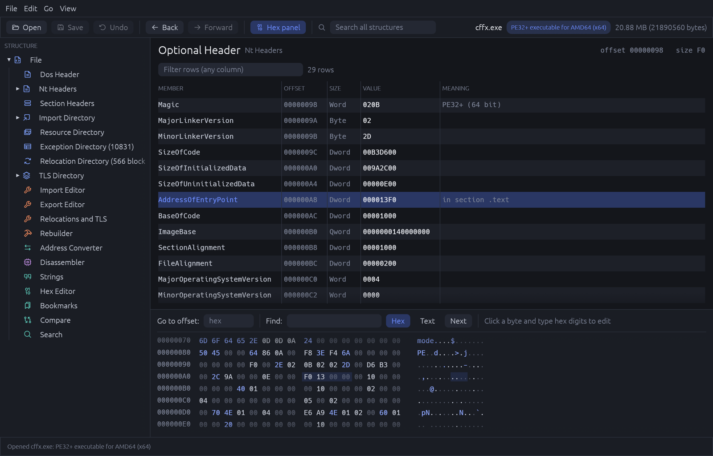
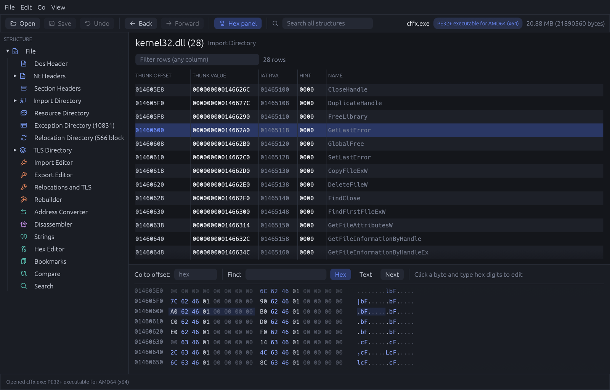
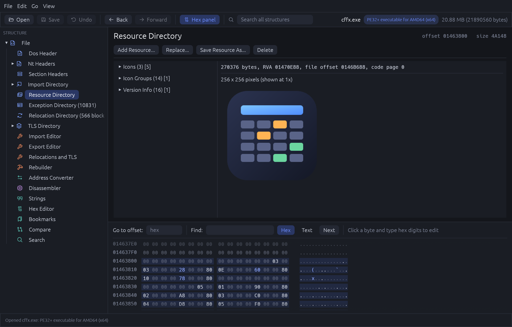
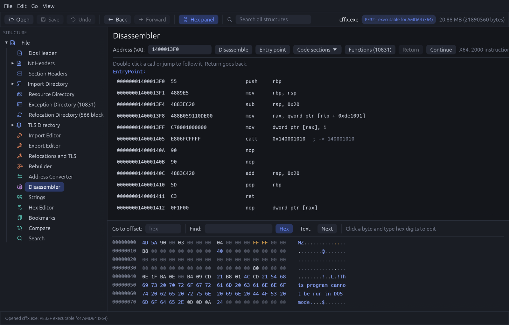
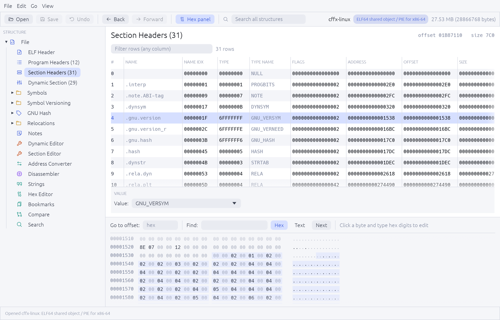
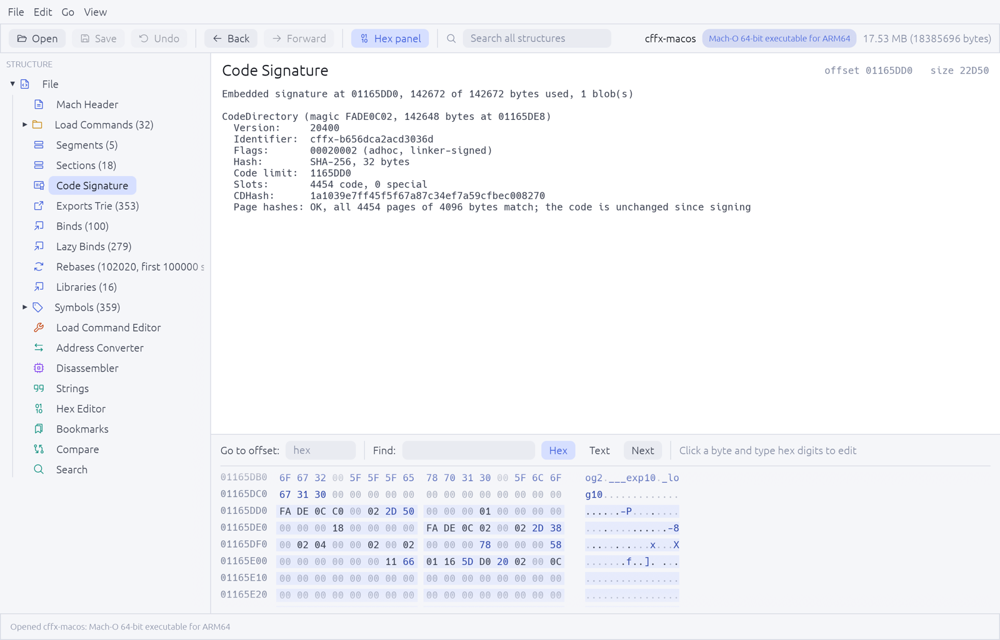

# bxplore - Binary eXplorer

`bxplore` is a viewer and editor for executable files, inspired by CFF Explorer, that runs
on Windows, macOS and Linux. It shows every structure of a file as a tree of editable tables,
next to a hex editor and a disassembler, and it can rebuild the parts of a file that other
tools only display: imports, exports, resources, sections, relocations and signatures.

| Format | Variants | Viewing | Editing |
| --- | --- | --- | --- |
| PE | PE32, PE32+, .NET | headers, directories, resources, .NET metadata and IL, Authenticode | sections, imports, exports, resources, relocations, TLS callbacks |
| ELF | 32 and 64 bit, both byte orders | headers, symbols, versioning, GNU hash, relocations, notes | dynamic section, sections |
| Mach-O | thin and universal | load commands, dyld data, Objective-C and Swift metadata, code signature | library and run path load commands |

Written in Rust with egui. The parsers and editors are a separate library with no GUI
dependencies.

**Contents:** [Screenshots](#screenshots) | [Features](#features) | [Build and run](#build-and-run) |
[Limits](#limits) | [Tests](#tests) | [Quality checks](#quality-checks) | [Fuzzing](#fuzzing) |
[Review workflow](#review-workflow)

## Screenshots

The files shown are bxplore's own builds for Windows, Linux and macOS.

**PE optional header.** The selected field is highlighted in the hex panel below the table.



<table>
  <tr>
    <td width="50%"><b>Imports of one module</b></td>
    <td width="50%"><b>Resources, with an icon preview</b></td>
  </tr>
  <tr>
    <td></td>
    <td></td>
  </tr>
  <tr>
    <td><b>Disassembler at the entry point</b></td>
    <td><b>ELF section headers (light theme)</b></td>
  </tr>
  <tr>
    <td></td>
    <td></td>
  </tr>
</table>

**Mach-O code signature.** Every code page hash is checked against the file (light theme).



## Features

### All formats

| Area | What it does |
| --- | --- |
| Structure tree | Every header as Member / Offset / Size / Value / Meaning, with icons by kind. |
| Editing in place | Double-click a highlighted value. Flag and enumeration fields get check boxes or a drop-down below the table. Undo with Ctrl/Cmd+Z. |
| Tabs | Several files at once (`bxplore a.exe b.dll`), Ctrl+Tab and Ctrl+Shift+Tab to switch, recent files list. |
| Navigation | Right click a hex value to follow it as RVA, VA or file offset, to the owning structure, the hex view or the disassembler. Back and Forward with Ctrl/Cmd+[ and ]. "Structure" in the hex panel jumps to whatever covers the cursor. |
| Search | Across all structures (Ctrl/Cmd+F, or the Search node). Row filter and copy (right click) in every table. |
| Compare | With another file or another open tab (drop the tab on the Compare view, or right click it): structure level diff plus a byte summary. |
| Bookmarks | With notes, remembered per file. |
| Patch export | The changes since the file was opened, as a readable list or as a Python script that reapplies them to the original. |
| Hex editor | Linked to the selection, with typing, go to offset and hex or text search. |
| Disassembler | x86, x64, ARM, ARM64. Import and symbol names and string literals as comments, labels at named addresses and function starts, a function list, double-click on a call or jump to follow it (Return goes back). |
| Tools | Address converter (VA, RVA, file offset), strings (ASCII and UTF-16), MD5, SHA-1, SHA-256, entropy. |
| Preferences | Theme, interface size, hex panel, backup on save, recent files, strings length. |
| File manager menu | "Open with bxplore" on executable files: Explorer's right-click menu on Windows, a Finder Quick Action on macOS, the Open With list on Linux. The Windows installer, Flatpak, snap and Nix package set it up; any other copy adds or removes it from Preferences, for the current user only. |

### PE

Viewing

- **Headers:** DOS, Rich, NT, optional headers, data directories, sections (with entropy).
- **Directories:** export, import, delay import, bound import, resource, exception, security,
  relocation, debug, TLS, load config, overlay.
- **.NET:** CLR header, metadata streams, all ECMA-335 metadata tables with names and
  signatures decoded, user strings and GUIDs, a method list, and an IL disassembler with
  resolved tokens and exception handling clauses. Table cells are editable.
- **Authenticode,** verified cryptographically: image digest, signed attributes, RSA and
  ECDSA (P-256, P-384) signatures, certificate chains, nested (dual) signatures, and
  timestamps (legacy counter signatures and RFC 3161 tokens).
- **Debug directory:** PDB path, GUID and age, with the symbol server key and URL.
- **Import hash** (imphash) compatible with pefile, including ordinal to name mapping.

Editing

- **Sections:** add (empty or from file), delete, dump.
- **Imports:** add imports, rename a module or function, remove a module, unbind bound
  imports, convert delay imports into ordinary imports.
- **Exports:** add, rename, delete, forward; writes a fresh export directory.
- **Relocations and TLS:** add or remove base relocations, add or remove TLS callbacks (the
  callback array is relocated as needed).
- **Resources:** preview (icons, bitmaps, version info, manifests, string tables), add,
  replace, delete, save; the resource section is rebuilt.
- **Rebuilder:** SizeOfImage, SizeOfHeaders, CheckSum, remove overlay or signature.

### ELF

Viewing

- **Structures:** header, program headers, section headers, dynamic section, symbol tables,
  relocations, notes (build id).
- **Symbol versioning** (per symbol versions, needed and defined versions) and the **GNU hash
  table,** with a check that every hashed symbol matches its chain entry.

Editing

- **Dynamic section:** add, rename and remove needed libraries; set or remove SONAME, RPATH
  and RUNPATH. Done in place when possible; otherwise the tables move to a new segment at the
  end of the file, mapped by turning the PT_NOTE program header into a PT_LOAD.
- **Sections:** add a data section from a file, remove or dump a section that is not loaded
  at run time.

### Mach-O

Viewing

- **Structures:** fat header, mach header, load commands, segments, sections, libraries,
  symbols (imports and exports).
- **Dynamic linking data:** exports trie, bind, weak bind, lazy bind and rebase opcode
  streams, and chained fixups (imports and every fixup in the chains).
- **Objective-C** classes with instance and class methods, type encodings and implementation
  addresses; **Swift** types with their module and parent types.
- **Code signature:** code directory, flags, team id, CDHash, entitlements, and a check of
  every code page hash.

Editing

- **Load commands:** add, change and remove library and run path commands in every
  architecture, remove the code signature command.

## Build and run

    cargo build --release
    ./target/release/bxplore [file]          # GUI; files can also be dropped on the window
    ./target/release/bxplore --dump <file>   # plain text dump of every structure

A C compiler is required at build time (the Capstone disassembler is compiled from source).
On Linux the usual GUI development packages are needed (GTK 3 for the file dialogs).

### Standalone executable

    cargo standalone                      # alias for: cargo build --profile standalone
    ./target/standalone/bxplore

The `standalone` profile inherits `release` and adds whole-program optimisation, one codegen
unit and symbol stripping. All Rust dependencies, Capstone, the fonts and the icons are inside
the one file. How static the result is depends on the platform (set in `.cargo/config.toml`):

- Windows (MSVC targets): the C runtime is linked statically, so the executable needs only DLLs
  that ship with Windows.
- macOS: only the system frameworks and `libSystem` are linked dynamically. Apple does not
  support linking those statically, and they are present on every Mac.
- Linux: the GUI loads the display and OpenGL libraries at run time, so it is built against
  glibc as usual. A fully static build is available for the command line tool:
  `cargo standalone --no-default-features --target x86_64-unknown-linux-musl`.

### Packages

`packaging/` builds the release packages: a portable zip and an NSIS installer for Windows, a
universal DMG for macOS, and a standalone executable, Flatpak and snap for Linux, each for
x86_64 and ARM64. GitHub releases carry all of them except the snap, which is built locally
only. See `packaging/README.md`.

### Nix

The flake builds for `x86_64-linux` and `aarch64-linux`. Run it without installing, or
install it into your profile:

    nix run github:portvex/bxplore
    nix profile install github:portvex/bxplore

To add it to your own flake, take it as an input and use its package. On NixOS:

```nix
{
  inputs = {
    nixpkgs.url = "github:NixOS/nixpkgs/nixos-unstable";
    bxplore = {
      url = "github:portvex/bxplore";            # or "github:portvex/bxplore/v0.1.0" for a release
      inputs.nixpkgs.follows = "nixpkgs";        # build against your nixpkgs, not a second copy
    };
  };

  outputs = { nixpkgs, bxplore, ... }: {
    nixosConfigurations.myhost = nixpkgs.lib.nixosSystem {
      system = "x86_64-linux";
      modules = [
        ./configuration.nix
        ({ pkgs, ... }: {
          environment.systemPackages = [ bxplore.packages.${pkgs.stdenv.hostPlatform.system}.default ];
        })
      ];
    };
  };
}
```

With Home Manager, put the same package in `home.packages` instead. The package installs the
desktop entry and icons, so bxplore appears in the application menu and under "Open With" for
executable files.

On NixOS the program runs as it is. With Nix on another distribution, the GUI needs
[nixGL](https://github.com/nix-community/nixGL) to find the graphics drivers (`nixGL bxplore`);
`bxplore --dump` works without it.

For development, `nix develop` opens a shell with the Rust toolchain, clippy, rustfmt and
rust-analyzer, and `nix build .` builds the checkout.

## Limits

- Editing a signed file invalidates its signature. A Mach-O file can be re-signed with
  `codesign -f -s - <file>`.
- Authenticode: whether a root is trusted by the operating system, the validity periods
  of the certificates, and revocation, are not checked. RSA-PSS and curves other than P-256 and P-384 are not verified.
- Mach-O code signature: page hashes are checked, the CMS signature over them is not.
- Mach-O load commands need free header padding, like `install_name_tool`. The linker
  leaves 32 bytes by default; `-headerpad` at link time gives more.
- Mach-O chained fixups: the 64 bit pointer formats used by macOS and iOS user code are
  decoded; kernel and firmware formats are listed but their chains are not walked.
  Objective-C and Swift metadata is read from 64 bit images only.
- ELF: growing the dynamic tables repurposes the PT_NOTE program header, so tools that
  find notes through program headers no longer see them (section headers still do).
  Edited ELF files are verified with GNU readelf in the tests but have not been run on Linux.
- PE: removing an import module leaves its IAT slots unresolved. Edited PE files,
  including converted delay imports and added TLS callbacks, are checked structurally
  on a linker-made test image but have not been loaded on Windows.
- .NET: custom attribute values and marshalling blobs are shown as raw data; generic
  parameters appear by position (`!0`, `!!0`), not by name.
- Disassembly is linear; function boundaries come from the x64 exception directory, ELF
  symbol sizes, or symbol names only.
- Universal Mach-O: address conversion and disassembly use the first architecture.
- File manager menu: on Windows 11 the entry is under "Show more options". On macOS it is
  a Quick Action, not an "Open With" entry, and each use starts a new window; the app does
  not receive files that Finder opens directly. The Windows registry entries are checked
  by unit tests on their content only and have not been tried on Windows.
- Save keeps the original once as `<name>.bak` (can be turned off in Preferences).
- Icons come from the bundled Phosphor icon font (MIT license, see `assets/`).

## Tests

`cargo test` runs:

- PE editor round trips against a real file named in `BXPLORE_TEST_PE` (skipped
  when unset; `BXPLORE_TEST_OUT=<dir>` keeps the edited files).
- `tests/fuzz_replay.rs`: the fuzz entry points over small synthetic PE, ELF
  and Mach-O files, truncations and deterministic mutations of them, and every
  input saved in `fuzz/regressions` and `fuzz/artifacts`.
  The same file tests the ELF and Mach-O editors, search, compare and disassembly
  annotation on the synthetic files, and compares their text dumps with
  `tests/snapshots` (regenerate with `BXPLORE_UPDATE_SNAPSHOTS=1`).
- `tests/macho_edit.rs`: compiles a C program, edits its load commands, checks the
  result with `otool`, re-signs it and runs it. macOS only, skipped elsewhere.
- `tests/elf_edit.rs`: edits cross-compiled ELF files and checks them with GNU
  `readelf`. Skipped unless a `*-linux-gnu-gcc` toolchain is installed.
- `tests/pe_fixture.rs`: compiles `tests/fixtures/pe/fixture.c` for Windows with clang and
  links it with lld-link, then runs the PE editors on that image (delay imports, TLS
  callbacks, relocations, imports, exports, sections). Skipped without clang and lld-link.
- `tests/signatures.rs`: the CMS verifier against RSA and ECDSA signatures and an
  RFC 3161 timestamp token made by OpenSSL (`tests/fixtures/make.sh` regenerates them).
- Unit tests for tabs, history, offset navigation, bookmarks, settings and the recent
  files list.

## Quality checks

| Check | Command | Runs in |
| --- | --- | --- |
| Format | `cargo fmt --all -- --check` (`rustfmt.toml`) | pre-commit hook |
| Lint | `cargo clippy --all-targets --all-features -- -D warnings` (`[lints]` in `Cargo.toml`) | pre-commit hook |
| Tests | `cargo test` | pre-push hook |
| Advisories | `cargo audit` | pre-push hook |
| Licenses, sources, advisories | `cargo deny check` (`deny.toml`) | pre-push hook |
| Unused dependencies | `cargo machete` | pre-push hook |

The hooks live in `.cargo-husky/hooks` and are copied into `.git/hooks` by
cargo-husky the first time `cargo test` builds. After editing a hook, run
`cargo clean -p cargo-husky && cargo test` to reinstall it. `cargo audit` and
`cargo deny` are skipped with a notice when the tools are not installed
(`cargo install cargo-audit cargo-deny`).

The minimum supported Rust version is 1.95 (`rust-version` in `Cargo.toml`), set by the
GUI stack. The `selftest` feature (off by default) adds environment driven screenshots
of the GUI for development: `BXPLORE_SCREENSHOT=<png>` with `BXPLORE_SELECT`, `BXPLORE_ROW`,
`BXPLORE_THEME`, `BXPLORE_SEARCH`, `BXPLORE_COMPARE`, `BXPLORE_DISASM`. `BXPLORE_CONFIG_DIR` moves the
recent files list away from the per-user configuration directory.

## Fuzzing

The parsers and editors are a library without GUI dependencies
(`--no-default-features`), fuzzed with libFuzzer through cargo-fuzz. This needs
a nightly toolchain and `cargo install cargo-fuzz`.

| Target | Covers |
| --- | --- |
| `parse_any` | detection, full parse, text dump, every editable field, disassembly at the entry point |
| `parse_each` | the PE, ELF and Mach-O parsers individually, strings |
| `pe_edit` | sections, imports, exports, resources, relocations, TLS callbacks, delay imports, header fix-ups, then re-parse |
| `resource_previews` | version info, string table, icon group and image decoders |
| `elf_edit` | the ELF dynamic section and section header editors, then re-parse |
| `macho_edit` | the Mach-O load command editor, then re-parse |
| `queries` | search, offset lookup and file comparison |
| `decoders` | Authenticode, Mach-O code signature and dynamic linking data, .NET metadata, signatures and IL, fed directly |

```
fuzz/run.sh                 # every target for 60 seconds
fuzz/run.sh pe_edit 600     # one target for 10 minutes
fuzz/triage.sh              # distinct failure locations of the saved crashes
```

`fuzz/coverage.sh [target|all]` reports which library code the corpus and seeds reach
(it needs `rustup component add llvm-tools-preview --toolchain nightly`).
`.github/workflows/fuzz.yml` runs every target for 30 minutes on a schedule and keeps
crash inputs and the coverage summary as artifacts.

A crash input is written to `fuzz/artifacts/<target>/`. Once fixed, move it to
`fuzz/regressions/<target>/` so `cargo test` replays it forever. The entry
points are in `src/fuzzing.rs`, shared by the fuzz targets and the tests.

## Review workflow

Workflow `review-until-clean` after code changes. 
It has three project subagents (`.claude/agents/`: Rust code reviewer, software
architect, UI/UX designer) review the changes, fixes what they report, and repeats until
all three report no issues.

## License

MIT, see [`LICENSE`](LICENSE). The bundled Phosphor icon font has its own MIT license
(`assets/Phosphor-LICENSE-MIT.txt`). The license file in every release package holds both notices.
